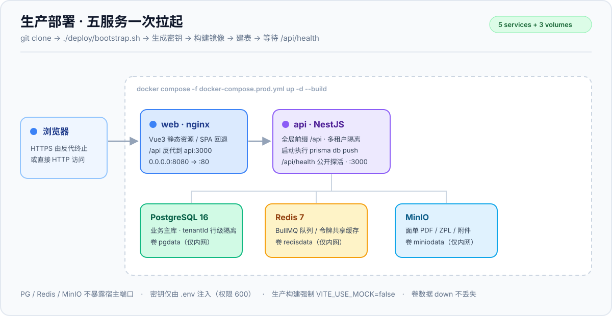
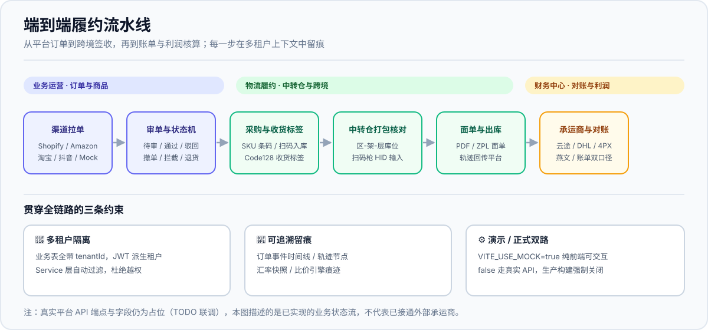
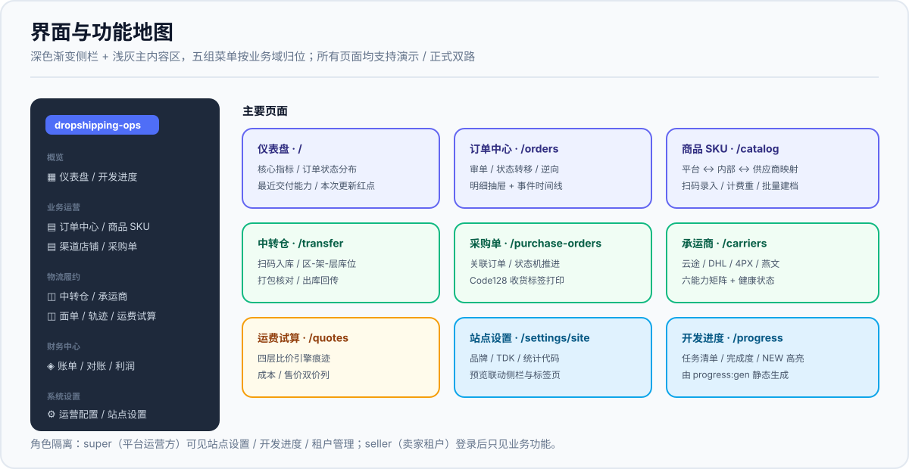

<div align="center">

# 🚢 一件代发货代运营系统 · dropshipping-ops

**把「渠道拉单 → 审单 → 采购收货 → 中转仓扫码 → 打包核对 → 面单 → 出库 → 跨境轨迹 → 账单对账」串成一条多租户履约流水线**

[](LICENSE)
[](https://nodejs.org/)
[](https://nestjs.com/)
[](https://vuejs.org/)
[](https://www.postgresql.org/)
[](server/src/)
[](https://github.com/fuyegongfang-star/dropshipping-ops/actions/workflows/ci.yml)

[⚡ 先看成果](#-先看成果30-秒无需-docker)　·　[🚀 一键部署](#-一键部署)　·　[🗺 功能地图](#-功能地图)　·　[🛠 本地开发](#-本地开发点击展开)　·　[📚 文档索引](#-文档索引)

</div>

> [!IMPORTANT]
> **诚实前置声明**：本项目已通过前后端 `lint` / `typecheck`、426 个 Jest 单测（61 suites）与生产构建，**但从未在真实 PostgreSQL / Redis / MinIO 上跑通完整链路**（开发沙箱无 Docker，本机 PG 亦停服）。真实平台 API 联调（云途 HMAC、DHL OAuth2、4PX / 燕文 MD5、淘宝 TOP、抖音 OAuth2）目前仍是**合理占位并标注 `TODO(ops)`**，适配器不会发起真实联网调用；承运成本 `carrierCost` 在回传前为 `null`，不伪造利润。Docker 镜像构建与 compose 启动**未在本机端到端执行过**，首次上线请按 [部署指南第六节](deploy/README.md#六首次上线核验清单逐条打勾再正式用) 逐条验收。
>
> 文中 `§xx` 编号指向内部架构方案 v1.5（未随本仓库发布）；关键约定已在本文档与 [`docs/DELIVERY.md`](docs/DELIVERY.md) 自包含，不影响运行。

---

## ⚡ 先看成果（30 秒，无需 Docker）

只想打开浏览器看到界面与交互、不装数据库？用**演示模式**：前端内置一套 mock 数据，纯前端渲染，审单 / 状态转移 / 逆向 / 拉单 / 加价规则都可操作。

```bash
git clone https://github.com/fuyegongfang-star/dropshipping-ops.git
cd dropshipping-ops
npm install --ignore-scripts
npm run dev --workspace web
# 打开 http://localhost:5173
```

由 `web/.env` 的 `VITE_USE_MOCK=true` 开启（默认值）。改回真实后端：删除该文件或设为 `false`，前端即走 `/api` 代理。演示模式下运营配置 / 站点设置的改动写入 `localStorage`，刷新保留，两页都提供「重置演示数据」。

> [!NOTE]
> **生产构建强制 `VITE_USE_MOCK=false`**。`vite.config.ts` 在 `mode=production` 时校验该值，缺省或 `true` 直接抛错拒绝构建，杜绝把演示假数据整站上线。用 `npm run build:prod` 即可。

---

## 🚀 一键部署

`clone` 之后一条命令，前端 / API / PostgreSQL / Redis / MinIO **全部起来**：

```bash
git clone https://github.com/fuyegongfang-star/dropshipping-ops.git /opt/dropshipping-ops
cd /opt/dropshipping-ops
./deploy/bootstrap.sh
```

脚本自动完成：生成 64 位 `APP_MASTER_KEY`、96 位 `JWT_SECRET`、48 位数据库口令与 MinIO 凭据 → 清空模板里所有 `<CHANGE_ME>` 占位符 → `.env` 权限 600 → `up -d --build` → API 容器启动时执行 `prisma db push` → 轮询 `/api/health` → 打印访问地址与一次性凭据。

**依赖只有** Docker Engine 24+、Compose v2、openssl、GNU sed；**不需要宿主机 Node / psql / nginx**（编译在镜像内，建表在容器内）。已存在 `.env` 时绝不覆盖，避免密钥轮换导致库里已加密的平台凭证不可解密。

| 场景 | 命令 |
| :--- | :--- |
| 挂宝塔 / nginx 反代 + HTTPS | `./deploy/bootstrap.sh --local` |
| 改对外端口 | `./deploy/bootstrap.sh --port 9000` |
| 只生成配置自检，不启动 | `./deploy/bootstrap.sh --env-only` |
| 已有镜像，快速重启 | `./deploy/bootstrap.sh --no-build` |
| 更新版本 | `git pull && ./deploy/bootstrap.sh` |
| 完整备份（库 + 附件卷） | `./deploy/backup.sh` |

> [!WARNING]
> 默认绑 `0.0.0.0` 且是 **HTTP 明文**。公网部署请在前面挂反代并启用 HTTPS；**端口放行两道缺一不可** —— 宝塔「安全」防火墙 + 云厂商安全组，只开 80/443，勿暴露 8080 / 5432 / 6379 / 9000。请离线备份 `.env`（`APP_MASTER_KEY` 丢失则已加密凭证不可解密）。

完整步骤、宝塔 Docker 管理器逐步操作、首次上线核验清单、故障对照表与回滚见 **[`deploy/README.md`](deploy/README.md)**。

---

## 🏗 架构：一次拉起五个服务



| 🚀 一键起全套 | 🔗 全链路可追溯 | 🔐 密钥不落地 |
| :--- | :--- | :--- |
| `bootstrap.sh` 自动生成密钥、构建镜像、建表、等健康检查；PG / Redis / MinIO 仅内网可达 | 订单事件时间线、轨迹节点、汇率快照、比价痕迹均留痕，多租户 `tenantId` 行级隔离 | 密钥只走环境变量与 `*.example` 模板；平台凭证 AES-256-GCM 加密落库，日志与仓库里看不到明文 |

---

## 🔄 端到端履约流水线



---

## 🖥 界面与功能地图



---

## 🗺 功能地图

| 菜单 | 路由 | 主要能力 |
| :--- | :--- | :--- |
| 仪表盘 | `/` | 核心指标统计卡、订单状态分布、**最近交付能力** |
| 订单中心 | `/orders` | 审单 / 状态转移 / 逆向、明细抽屉与事件时间线 |
| 商品 / SKU | `/catalog` | 平台 ↔ 内部 ↔ 供应商三段映射、扫码建档、计费重 |
| 渠道 / 店铺 | `/channels` | 店铺列表、Mock 店一键拉单 |
| 采购单 | `/purchase-orders` | 关联订单、状态机推进、**Code128 收货标签打印** |
| 中转仓 | `/transfer` | 区-架-层库位、扫码入库、打包核对、出库回传 |
| 承运商管理 | `/carriers` | 云途 / DHL / 4PX / 燕文 · 六能力矩阵 + 健康状态 |
| 运费试算 | `/quotes` | 四层比价引擎痕迹 + 成本 / 售价双价列 + 渠道自选 |
| 运营配置 | `/pricing` | 加价规则可增删改、汇率调整、效果预览 |
| 站点设置 | `/settings/site` | 站点名称 / 品牌 / 首页与页面 TDK / 统计代码 / SERP 预览 |
| 租户管理 | `/tenants` | 多租户切换与隔离验证 |
| 开发进度 | `/progress` | 任务清单 / 完成度 / 最近交付（自动开发产出可视化） |

---

## 🧰 技术栈

| 层 | 选型 |
| :--- | :--- |
| 后端 | Node 20 + NestJS 10 + TypeScript，按 feature 切模块 |
| 数据 | PostgreSQL 16 + Prisma 5（`prisma db push`，暂无 migrations 目录） |
| 队列 / 缓存 | BullMQ + Redis 7；`common/cache` 支持内存 / Redis 双后端，Redis 不可用优雅降级 |
| 对象存储 | MinIO（面单 PDF / ZPL / 附件） |
| 前端 | Vue 3 + Vite 5 + TypeScript + Element Plus + Pinia + ECharts |
| 部署 | Docker 多阶段构建 + nginx（SPA + `/api` 反代） |
| 规范 | Prettier + ESLint + Stylelint + Conventional Commits |

---

<details>
<summary><b>🎨 UI 设计体系（点击展开）</b></summary>

前端遵循统一设计系统，令牌集中在 `web/src/styles/theme.css`，在 Element Plus 官方样式**之后**覆盖其 CSS 变量，因此无需 sass 或额外构建插件。

- **品牌主色**：靛蓝渐变家族（`#4F6EF7 → #3047C4`），辅以青 / 橘 / 紫作语义强调；中性灰阶采用 Slate 色板。
- **布局**：深色渐变侧边栏（图标菜单 + 可折叠）＋ 白底轻阴影顶栏 ＋ 浅灰主内容区。
- **圆角与阴影**：卡片 16px 圆角、柔和分层阴影、悬停上浮。
- **状态分级**：订单 / 租户 / 平台状态统一使用柔和胶囊标签（绿 / 琥珀 / 红 / 蓝 / 青）。
- **图标**：`web/src/components/AppIcon.vue` 零依赖内联 SVG 线性图标集，不引入图标字体。
- **统一页头**：`web/src/components/PageHeader.vue`（图标徽章 + 标题 / 副标题 + 右侧操作插槽）。
- **动效**：路由 fade-slide 过渡、按钮与卡片悬停位移，克制统一。

涉及文件：`styles/theme.css`、`layouts/BasicLayout.vue`、`components/AppIcon.vue`、`components/PageHeader.vue`、`views/{Dashboard,Orders,Catalog,Channels,Tenants}View.vue`。
约定：新增页面请沿用 `var(--*)` 令牌，避免散落的硬编码色值。

</details>

<details>
<summary><b>🛠 本地开发（点击展开）</b></summary>

前置：Node.js 20+、npm、Docker（用于 PG / Redis / MinIO）。

```bash
# 0. 仓库根目录安装依赖（workspaces 一并装 server / web）
npm install --ignore-scripts

# 1. 生成 Prisma Client
npm run prisma:generate --workspace server

# 2. 启动基础设施
docker compose -f deploy/docker-compose.yml up -d

# 3. 建表（按 schema 直接推送，无需迁移历史，适合本地演示）
cd server && cp .env.example .env && npx prisma db push && cd ..

# 4. 写入演示数据：租户 demo + 店铺 + 商品 / SKU + 多状态订单
npm run seed --workspace server

# 5. 启动后端（:3000）
npm run start:dev --workspace server

# 6. 另开终端启动前端（:5173）
npm run dev --workspace web
```

打开 **http://localhost:5173**，右上角已默认选中 `demo` 租户。

**建议体验路径**：订单中心点「详情」试审单 / 状态转移 / 逆向 → 渠道中心对 Mock 演示店点「拉单」→ 商品 / SKU 看三段映射与计费重 → 租户管理新建租户验证行级隔离。

> 生产部署请用 `npx prisma migrate dev --name init` 管理迁移，而非 `db push`；并收紧 CORS 与 `x-tenant-id` 校验。

**质量门禁**：

```bash
npm run lint                              # 两个 workspace
npm run typecheck                         # server tsc --noEmit
npx vue-tsc --noEmit -p web/tsconfig.json
npm run test --workspace server           # 426 passed / 61 suites
npm run build --workspace server
npm run build:prod --workspace web        # 强制 VITE_USE_MOCK=false
npm run progress:gen                      # 重新生成 web/src/api/dev-progress.ts
```

</details>

<details>
<summary><b>🔐 角色隔离与交付形态（点击展开）</b></summary>

演示脚手架与内部视图都做了隔离，**上线交付无需删代码**。

| 组件 | 隔离方式 | 交付时动作 |
| :--- | :--- | :--- |
| Mock 演示数据 | 环境变量 `VITE_USE_MOCK`（默认 true） | 交付设 `false`，前端改走真实后端 `/api` |
| 加价规则本地持久化 | 仅 mock 分支写 `localStorage` | 正式模式走后端 API 落库 |
| 站点设置 / 开发进度页 / 本次更新 / 租户管理 | 角色 `super` 专属（菜单过滤 + `meta.roles` 路由守卫） | 卖家租户登录后自然看不到 |

- 角色定义见 `web/src/stores/user.ts`：`super`（平台运营方）/ `seller`（卖家租户）。演示模式顶栏可切换身份验证隔离；真实部署应由登录接口返回并写入该 store。
- ⚠️ **前端显隐只是体验层，不替代后端鉴权** —— 接口侧仍须按角色做权限校验。
- 多租户：所有业务表带 `tenantId`；租户上下文由 `common/tenant` 中间件从 JWT 派生（忽略客户端自报 `x-tenant-id`），注入 `AsyncLocalStorage` 供 Service 层自动过滤。

</details>

<details>
<summary><b>📈 开发进度可视化（点击展开）</b></summary>

夜间自动开发每完成一批任务，会运行进度生成器把 `dev-schedule.md` 的任务表同步到前端：

```bash
npm run progress:gen   # 生成 web/src/api/dev-progress.ts（任务清单 / 统计 / 最近交付）
```

生成物是静态数据，**演示模式与正式模式都直接可读**，次日刷新即可在左侧菜单「开发进度」（`/progress`）、仪表盘「最近交付能力」卡片、顶栏铃铛「本次更新」红点看到新产出。该机制已写入夜间自动化的「可视化交付铁律」：业务任务必须同时交付页面 / 菜单 / 路由与 mock 数据，纯后端任务至少在进度页有条目。

</details>

<details>
<summary><b>🧪 验证状态（点击展开）</b></summary>

| 项 | 结果 |
| :--- | :--- |
| `npm run lint`（server + web） | ✅ 通过（2026-11-10 巡检） |
| `tsc --noEmit` / `vue-tsc --noEmit` | ✅ 通过 |
| Jest 单元测试 | ✅ **426 / 426**（61 suites，本机实跑） |
| `npm run build:prod`（`VITE_USE_MOCK=false`） | ✅ 通过（2376 模块，仅 chunk >500kB 体积提示） |
| `progress:gen` | ✅ 74 任务 / 74 完成 |
| GitHub Actions CI（lint + typecheck + prisma generate） | ✅ 首次 push 自动运行 `success` |
| `deploy/*.sh` 语法 / LF / 无 BOM | ✅ `sh -n` 通过 |
| 真实 PostgreSQL / Redis / MinIO 端到端 | ⚠️ **待环境**，本机 PG 停服、沙箱无 Docker |
| Docker 镜像构建与 compose 启动 | ⚠️ **待环境**，首次上线按核验清单逐条验证 |
| 真实平台 API 联调 | ⚠️ **未完成**，端点与字段为占位，明确标注 `realApiTodo=true` |

CI 只覆盖 lint / typecheck / prisma generate，**426 个单测是本机实跑结果，不是流水线徽章**。

</details>

<details>
<summary><b>📁 目录结构（点击展开）</b></summary>

```
dropshipping-ops/
├── server/                    NestJS 后端（src / prisma / Dockerfile）
│   ├── src/common/            多租户、鉴权、统一响应、缓存、加解密
│   ├── src/modules/           按 feature 切分的业务模块
│   └── prisma/schema.prisma   全量数据模型（含 tenantId）
├── web/                       Vue3 前端（src / Dockerfile / .env.production）
├── deploy/                    bootstrap.sh、backup.sh、nginx.conf、模板、本地 compose
├── docs/                      架构图 / 流水线图 / 界面图（SVG）、交付状态总览
├── scripts/                   进度生成器、保活等工具脚本
├── .github/workflows/ci.yml   CI 基线
├── docker-compose.prod.yml    生产编排（5 服务）
├── dev-schedule.md            开发进度真相源
└── progress-log.md            夜间自动开发日报
```

</details>

---

## 📚 文档索引

| 文档 | 内容 |
| :--- | :--- |
| [`deploy/README.md`](deploy/README.md) | **生产部署指南**（一键部署 / 宝塔路线 / 核验清单 / 故障排查 / 回滚） |
| [`docs/DELIVERY.md`](docs/DELIVERY.md) | 交付与集成状态总览、桥接状态表、**诚实待办清单** |
| [`deploy/.env.prod.example`](deploy/.env.prod.example) | 生产环境变量模板（仅占位符） |
| [`server/.env.example`](server/.env.example) | 本地后端环境变量模板 |
| [`dev-schedule.md`](dev-schedule.md) | 开发进度表（唯一进度真相源） |
| [`progress-log.md`](progress-log.md) | 夜间自动开发日报 |
| [`中转仓流程审计.md`](中转仓流程审计.md) | 中转仓作业流程审计 |
| [`docs/architecture.svg`](docs/architecture.svg) · [`pipeline.svg`](docs/pipeline.svg) · [`interface.svg`](docs/interface.svg) | 架构 / 流水线 / 界面自绘图 |

---

## 🔐 安全约定

- 密钥与口令只走环境变量 + `*.example` 占位模板，禁止硬编码、禁止写入日志；平台凭证经 AES-256-GCM 加密落库，接口不返回明文。
- 生产环境缺失 `JWT_SECRET` / `APP_MASTER_KEY`（或仍为 `change-me-in-prod`）时**服务直接拒绝启动**，不静默降级。
- 租户上下文以 JWT 派生为准，忽略客户端自报 `x-tenant-id`；数据库查询参数绑定，用户输入统一转义。
- `server/.env.example` 与 `deploy/docker-compose.yml` 中的 `postgres/postgres`、`minioadmin/minioadmin`、`change-me-in-prod` 都是**本地开发占位默认值**，**上线前必须全部替换**（一键脚本会自动随机化）。
- 仓库不含 `.env`、`node_modules/`、`dist/`、私钥与任何真实密钥；`.gitattributes` 锁定全仓 LF，避免 Linux 容器脚本因 CRLF 启动失败。

## 📄 许可证

[MIT](LICENSE) © 2026 fuyegongfang-star —— 可自由使用、修改、商用，保留版权声明即可。

---

<div align="center">

如果这个项目对你有用，点个 ⭐ 就是最大的支持；问题与建议欢迎提 Issue。

</div>
